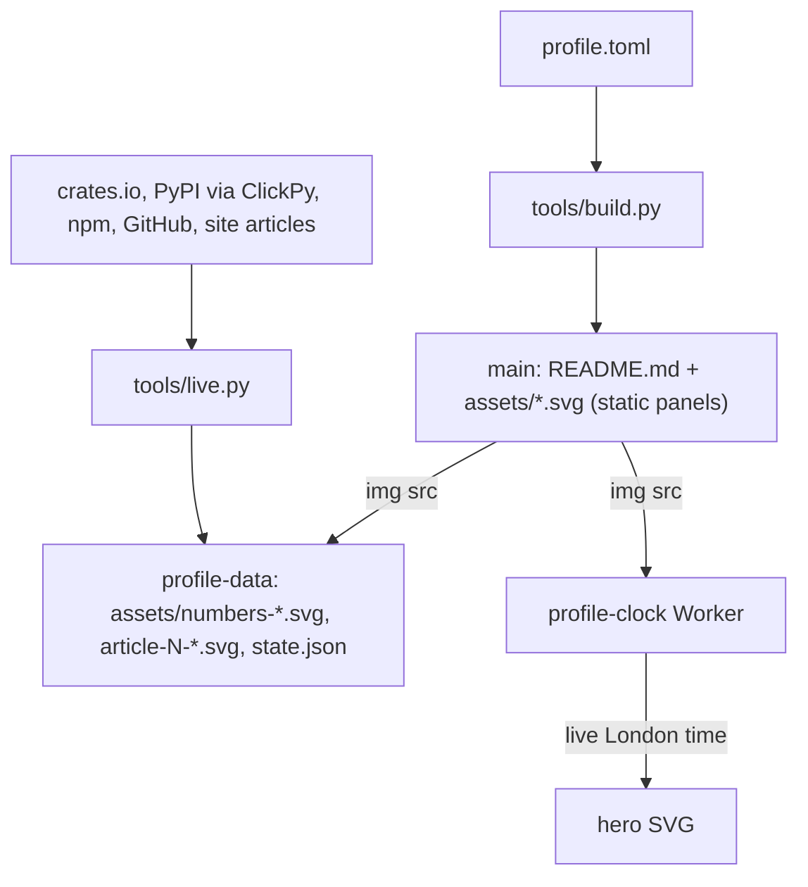

# Architecture

## What it makes

`profile.toml` is the single source of truth for the profile. Two pipelines
turn it into what visitors see.

* **Static panels** (hero, cards, sections, paper, finale) are a pure
  function of `profile.toml` and `tools/`. `make` writes them to `main`.
  CI rebuilds and fails on any difference, so the committed files can
  never drift.
* **Live panels** (the numbers and the three latest articles) change every
  few hours. They are rendered onto the `profile-data` branch so a refresh
  never needs a commit to the protected `main`. `README.md` points at that
  branch's raw files.
* **The hero clock** is served by a separate Cloudflare Worker (source in
  the sebastienrousseau.github.io repository, `workers/clock.js`). It
  replaces the `/*clock*/` marker in the committed hero SVG with CSS that
  sets London time, and redirects to the static SVG if anything fails.

## Modules

| File | Role |
| --- | --- |
| `tools/build.py` | Static build: panels and `README.md`. No network except the pinned fonts. |
| `tools/live.py` | Live build: fetch, validate, render, save state. |
| `tools/metrics.py` | One function per registry. Returns numbers, never publishes. |
| `tools/articles.py` | Latest articles from the site's `/articles/` index. |
| `tools/net.py` | The only network code: curl with timeouts, bounded retries, `Retry-After`, token on stdin. |
| `tools/panels.py` | Each panel as a function of a theme and config; `write()` also deletes orphan SVGs. |
| `tools/fonts.py` | Pinned font sources, per-SVG subsetting, text measurement. |
| `tools/svg.py`, `tools/theme.py` | SVG builder and colour tokens. |
| `tools/commit.sh` | Signed commits through the GraphQL API; creates `profile-data` on first run. |
| `tools/alert.sh` | Opens or closes the "profile data is stale" issue. |

## How the live numbers stay current

`.github/workflows/refresh.yml` runs every three hours, on every merge that
touches the tools or `profile.toml`, and on demand.

1. Each source is fetched on its own. A failed source keeps its last good
   value, so one outage never freezes the others.
2. A value is held (and the previous one kept) if it falls past a band in
   `BANDS`: all-time totals cannot really drop, and a partial API response
   looks exactly like a collapse. The summary logs what the source returned.
3. A source older than two days fails the run. The workflow still publishes
   the panels first, then opens an issue; a healthy run closes it.
4. The numbers panel says when its oldest figure was fetched.

Two sources need care:

* **npm** rate-limits hard. A ledger in `state.json` keeps each package's
  settled history and last result. A normal run asks npm for one range of
  daily counts per package, oldest first, and stops at the first refusal.
  The published figure sums each package's latest result, so a throttled
  run still publishes a complete number.
* **ClickPy** (PyPI downloads) sometimes answers from a replica missing
  older rows. All-time totals only grow, so the query runs four times and
  keeps the fullest answer.

## Decisions

* **Live data off `main`.** `main` requires a pull request and a passing
  `check`, which a bot pushing every few hours cannot meet. Keeping live
  output on its own branch keeps both properties.
* **curl, not an HTTP library.** The site's TLS is negotiated by curl where
  urllib fails. `net.py` is the only place that shells out.
* **Fonts embedded, subsetted per SVG.** An SVG shown through an ``
  tag cannot load external resources, so each panel carries only the glyphs
  it draws, as base64 WOFF2. Panels render in the site's typefaces
  anywhere. The sources are pinned by SHA-256.
